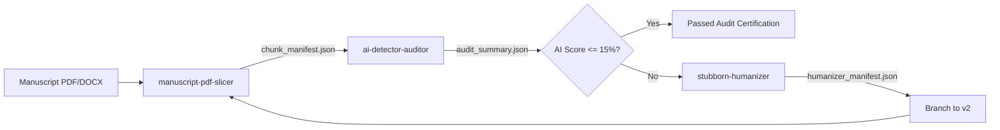

# Academic Manuscript AI Auditing & Humanization Suite

[](https://skillsmp.com)
[](https://opensource.org/licenses/MIT)

An enterprise-grade, verifiable AgentSkill suite for automated academic manuscript preprocessing, multi-worker AI detection auditing, and cascading humanization. Conforms strictly to the **SkillsMP Engine 2.0 Specification**.

---

## Suite Architecture & Skills



### Included Skills

| Skill | Directory | Mandate |
| :--- | :--- | :--- |
| **`manuscript-pdf-slicer`** | [`./manuscript-pdf-slicer/`](./manuscript-pdf-slicer/) | Slices multi-page manuscripts into page-bounded chunks; enforces Ghostscript `/ebook` compression to guarantee chunk size stays $< 2.10$ MB (defeating platform upload limits). |
| **`ai-detector-auditor`** | [`./ai-detector-auditor/`](./ai-detector-auditor/) | Runs parallel tiled Chrome GUI sessions (**`headless=False` ALWAYS**); enforces strict visible-digit regex gating (`^\d{1,3}%$`); captures screenshot proof gallery; reports simple and word-weighted averages. |
| **`stubborn-humanizer`** | [`./stubborn-humanizer/`](./stubborn-humanizer/) | 3-stage cascading humanization: Stage 0 (typographic/syntactic heuristics: em-dash stripping, arrow normalization, parenthetical spacing), Stage 1 (2-strike automated gate), and Stage 2 (micro-slicing $<180$ words and JSON HITL candidate resolver). |

---

## Standardized Workspace Scaffolding

Any AI agent consuming this suite in an empty directory automatically organizes all outputs into a **Document-Centric, Versioned Hierarchy**:

```
./<file_stem>/
├── v1/
│   ├── chunks/                         # Created by manuscript-pdf-slicer
│   │   ├── page_01.pdf                 # Compressed (<500 KB)
│   │   ├── page_02.pdf
│   │   └── chunk_manifest.json
│   ├── ai-score/                       # Created by ai-detector-auditor
│   │   ├── screenshots/                # Real-time visual proof gallery
│   │   │   ├── page_01_0pct.png
│   │   │   └── page_08_38pct.png
│   │   ├── scan_session_manifest.json
│   │   ├── audit_summary.json
│   │   └── audit_report.md
│   └── humanized/                      # Created by stubborn-humanizer
│       ├── candidates/
│       └── humanizer_manifest.json
└── v2/                                 # Auto-scaffolded for re-audit pass
    ├── chunks/
    └── ai-score/
```

---

## Installation & System Requirements

### Prerequisites
- **Python**: `>= 3.10`
- **Google Chrome**: Installed on host system (`google-chrome --version`)
- **Ghostscript**: `gs` (10.x recommended)
- **WSLg / Linux Display**: Ensure `DISPLAY` and Wayland sockets are active:
  ```bash
  export DISPLAY=:0
  export WAYLAND_DISPLAY=wayland-0
  export XDG_RUNTIME_DIR=/mnt/wslg/runtime-dir
  ```

### Python Dependencies
```bash
pip install playwright pypdf pydantic rich
playwright install chromium
```

---

## Quickstart Pipeline Execution

### Step 1: Slice Manuscript & Enforce Compression
```bash
python -m manuscript_pdf_slicer.scripts.cli --source ./thesis.pdf --version v1
```

### Step 2: Run Multi-Worker Chrome GUI Audit (headless=False ALWAYS)
```bash
python -m ai_detector_auditor.scripts.cli --file-stem thesis --version v1 --workers 2
```

### Step 3: Remediate High-Scoring Chunks & Branch to v2
```bash
python -m stubborn_humanizer.scripts.cli --file-stem thesis --version v1 --threshold 15
```

---

## Verification & Integrity Invariants

1. **The Anti-False-Zero Invariant**:
   - Classifiers often render placeholder dashes (`-`, `—`) or empty circles while computing.
   - The auditor strictly asserts visible percentage digits matching `re.compile(r'^\d{1,3}%$')` on the meter and verifies against background API responses (`capi.grammarly.com`). It will never record `0%` on empty or stalled meters.
2. **Mandatory Chrome GUI Mode (`headless=False`)**:
   - Headless execution is forbidden. Real Google Chrome (`channel="chrome"`) with visible screen geometry tiling must be used to defeat bot detection and guarantee proper React DOM hydration.
3. **Upload Ceiling Protection**:
   - Single-page PDF slices that retain global fonts/images easily exceed 5.5 MB. The slicer applies Ghostscript 1.4 `/ebook` compression, reducing files to 20 KB – 450 KB.
4. **Token Ceiling Protection**:
   - Auxiliary rewriting tools reject text exceeding 200 words with HTTP 400 errors. The humanizer enforces micro-chunk partitioning strictly $< 180$ words.

---

## License

Distributed under the MIT License. See `LICENSE` for details.
